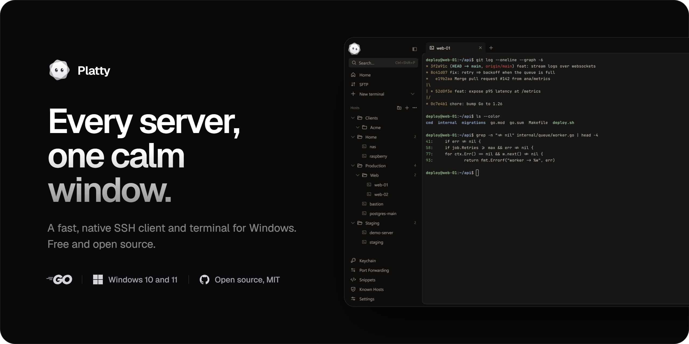

  <a href="https://plattyssh.github.io">Website</a> ·
  <a href="https://plattyssh.github.io/docs/">Docs</a> ·
  <a href="https://github.com/PlattySSH/platty/releases">Download</a> ·
  <a href="https://github.com/PlattySSH/platty/issues">Issues</a>

Platty brings your hosts, keys, tunnels, SFTP and snippets into one window. It's written in Go and drawn on the GPU, with a terminal built from scratch, and everything you save stays encrypted on your PC.

The pieces that make it work are small Go libraries you can use on their own:

| Repository | What it is |
|---|---|
| [platty](https://github.com/PlattySSH/platty) | The app |
| [vt](https://github.com/PlattySSH/vt) | A VT terminal emulator with no GUI: parser, screen state, reflow and input encoding |
| [conpty](https://github.com/PlattySSH/conpty) | Start processes in a Windows pseudo console |
| [glyphs](https://github.com/PlattySSH/glyphs) | A cached glyph rasterizer with color emoji, font fallback and ligatures |
| [plattyssh.github.io](https://github.com/PlattySSH/plattyssh.github.io) | The website and documentation |

Everything is MIT licensed. Ideas and bug reports are welcome.
