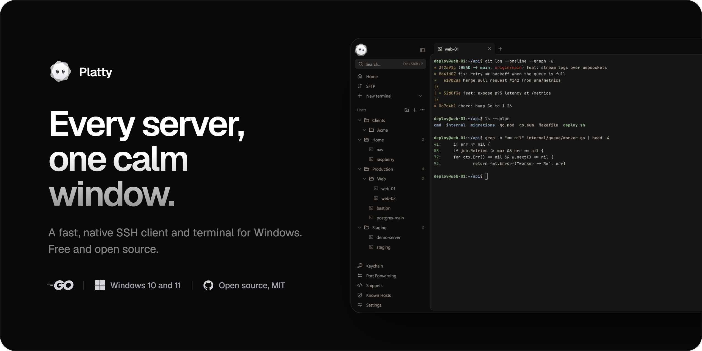

  <a href="https://github.com/northlighthq/boreal/releases"><b>Download boreal for Windows</b></a>
  &nbsp;·&nbsp;
  <a href="https://github.com/northlighthq/boreal/issues/new/choose">Report a bug</a>
  &nbsp;·&nbsp;
  <a href="https://github.com/northlighthq/branding">Brand</a>

### What we're building

Northlight makes tools for people who run servers. The first one is Boreal, a fast, native SSH client and terminal for Windows: hosts, keys, tunnels, SFTP and snippets in one window. It's written in Go and drawn on the GPU, with a terminal built from scratch. Backups come next. No accounts, no telemetry, and everything you save stays encrypted on your machine.

### Repositories

 [`boreal`](https://github.com/northlighthq/boreal)\
The SSH client: hosts, terminal, SFTP, tunnels and keys in one window.

 [`vt`](https://github.com/northlighthq/vt)\
A VT terminal emulator for Go with no GUI attached.

 [`pty`](https://github.com/northlighthq/pty)\
Start processes in a pseudo terminal on Windows, Linux and macOS.

 [`glyphs`](https://github.com/northlighthq/glyphs)\
A glyph rasterizer with color emoji, font fallback and ligatures.

 [`landing`](https://github.com/northlighthq/landing)\
The Northlight website.

 [`branding`](https://github.com/northlighthq/branding)\
The Northlight logo, colors and type, and the boreal mascot.

### Get involved

boreal is in beta and grows with every release. Try it, [share an idea](https://github.com/northlighthq/boreal/issues/new/choose) or read the [contributing guide](https://github.com/northlighthq/.github/blob/main/CONTRIBUTING.md). Everything is MIT licensed.
